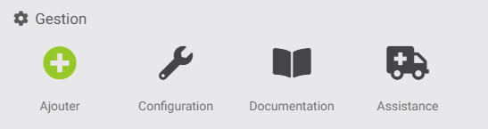
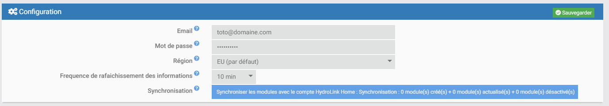

# Plugin Saur Client (saurclient)

Ce plugin sert à récupérer les données des adoucisseurs connectés SaurClient.

## Gestion du plugin :
- 
  - **Configuration** : Configuration du plugin
  - **Documentation** : Lien vers la docuementation du plugin (cette page)
  - **Assistance** : Lien permettant d'aller sur le forum directement sur les sujets SaurClient

## Configuration du plugin :
- 
  - **Email** : Email du compte Saur Client
  - **Mot de passe** : Mot de passe du compte Saur Client
  - **Region** : Region d'appartenance du compte (saurclient.**EU** ou saurclient.**COM**)
  - **Frequence de rafaichissement** : Fréquence à laquelle le plugin ira récupérer la mise à jour des informations sur le serveur SaurClient (10 min par défaut)
  - **Synchronisation** : Bouton premettant de synchroniser manuellement le plugin avec le compte SaurClient (récupération des appareils, mise à jour des informations)

## Affichage des appareils :
- 

  -Tous les appareils rattachés au compte seront affichés ici

## Parametres des appareils :
- 
  - **Identifiant de l'appareil** : Identifiant technique de l'appareil. Il ne peut pas être modifié
  - **Description** : Champ libre de saisie
  - **Date création** : Date de création de l'équipement dans jeedom
  - **Date mise à jour** : Date de mise à jour de l'équipement dans jeedom
  - **Nom** : Nom et prénom lié à l'appareil
  - **Localisation** : Localisation de l'appareil
  - **SSID Wifi** : Nom du Wifi auquel est rattaché l'appareil
  - **Aperçu** : Image d l'appareil

## Informations récupérées :
- Ce jour (gallons_used_today) : Cette donnée ....

## Commandes action
- Rafraichir (refresh) : Action permettant de rafraichir les données à la demande